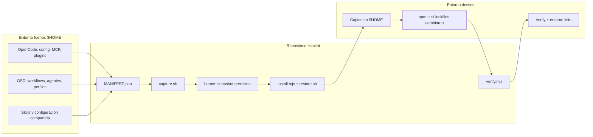

# OpenCode Habitat 🌿

Habitat versiona y restaura un ecosistema de OpenCode —configuración, GSD, agentes, skills, MCPs, plugins y herramientas— en otra máquina. Usa un manifiesto explícito, copias con backup y verificación al final.

`capture` → actualiza el snapshot del repo · `install/restore` → reconstruye el entorno · `verify` → comprueba que quedó operativo.

  

> **Recomendación por sistema:** Windows → WSL 2 + Ubuntu; Linux → terminal Bash; macOS → Bash con Homebrew. El instalador detecta los cuatro entornos. La validación end-to-end registrada se hizo en Linux/WSL; Windows nativo y macOS necesitan las herramientas POSIX detalladas abajo.

## Instalación desde una terminal nueva

### 1. Preparar el sistema

Se requieren **Git**, **Node.js 22.22.2+ / 24.15+ / 26+ y npm**, **Bash**, **rsync** y **coreutils** (`sha256sum`, `realpath`). Las versiones de Node reflejan el engine del lockfile actual. También necesitas acceso al repo privado y OpenCode instalado en el mismo entorno donde ejecutarás Habitat.

#### Windows (recomendado: WSL 2 + Ubuntu)

En PowerShell, instala Ubuntu si WSL aún no está configurado y reinicia si Windows lo solicita:

```powershell
wsl --install -d Ubuntu
```

Abre Ubuntu desde el menú Inicio y, dentro de esa terminal Linux, instala las herramientas base:

```bash
sudo apt update
sudo apt install -y git bash rsync coreutils
```

Instala una versión compatible de Node.js (22.22.2+, 24.15+ o 26+) desde [Node.js](https://nodejs.org/en/download) y OpenCode **dentro de Ubuntu/WSL** siguiendo sus instrucciones oficiales: [OpenCode — instalación](https://opencode.ai/docs/). No ejecutes esta instalación desde `/mnt/c`: usa el filesystem Linux (`~/code/habitat`) para evitar problemas de permisos y rendimiento.

> OpenCode y Habitat instalados en Windows y en WSL son entornos distintos. Para el flujo recomendado, autentica OpenCode dentro de WSL. Windows nativo también es detectado por el instalador, pero `restore.sh` requiere Bash y utilidades POSIX disponibles en `PATH`; esa variante aún no cuenta con la validación end-to-end de WSL.

#### Linux (Debian / Ubuntu)

```bash
sudo apt update
sudo apt install -y git bash rsync coreutils
```

Instala una versión compatible de Node.js (22.22.2+, 24.15+ o 26+) y npm desde [Node.js](https://nodejs.org/en/download), y OpenCode según sus instrucciones oficiales: [OpenCode — instalación](https://opencode.ai/docs/). En distribuciones donde el paquete del sistema sea anterior a esas versiones, instala Node desde el sitio oficial antes de continuar.

#### macOS

Instala Xcode Command Line Tools si aún no tienes Git y Homebrew si no está instalado. Luego:

```bash
brew install git node rsync coreutils
export PATH="$(brew --prefix coreutils)/libexec/gnubin:$PATH"
```

Ese `PATH` hace visibles `sha256sum` y `realpath` de GNU coreutils para las herramientas de restore. Mantén la terminal Bash abierta para la instalación. Instala OpenCode siguiendo [OpenCode — instalación](https://opencode.ai/docs/).

### 2. Clonar, autenticar e instalar

En WSL, Linux o macOS, desde una terminal Bash:

```bash
mkdir -p ~/code
git clone https://github.com/FacundoECornet/Habitat.git ~/code/habitat
cd ~/code/habitat

# Autenticar OpenCode en este mismo entorno antes de verificar modelos
opencode auth login

# Instalación completa: dependencias, GSD, restore del manifiesto y verify
node tools/install.mjs --with-deps --with-gsd
```

El repo es privado: GitHub debe autenticarte por SSH o HTTPS para que `git clone` funcione. El instalador crea `~/.config/opencode/jev.env` desde la plantilla si no existe; **no escribe credenciales**. Para habilitar clasificación JEV, añade en ese archivo una key propia (`TYPESAFE_API_KEY`) y abre una terminal Bash nueva. Sin credenciales JEV, la instalación funciona, pero el router de dificultad no cambia el perfil y devuelve código `2` de forma segura.

La instalación completa:

1. Detecta SO y arquitectura.
2. Con `--with-deps`, instala `get-shit-done-cc`, `context-mode` y Graphify.
3. Con `--with-gsd`, instala GSD y reaplica los bloques Habitat solo si sus checksums coinciden.
4. Copia las herramientas ejecutables a `~/bin` (crea backup si ya existen).
5. Crea `jev.env` desde el ejemplo solo si falta.
6. Restaura las rutas permitidas por `MANIFEST.json`, ejecuta `npm ci` cuando los lockfiles cambiaron y respalda archivos que va a reemplazar.
7. Ejecuta `tools/verify.mjs` y reporta resultados.

Para restaurar sin instalar dependencias globales ni GSD:

```bash
node tools/install.mjs
```

> El instalador no instala OpenCode ni realiza el login del proveedor; esos pasos son previos. Los flags `--with-deps` y `--with-gsd` habilitan los componentes adicionales.

### 3. Comprobar la instalación

```bash
node tools/verify.mjs
node tools/verify.mjs --json          # salida para scripts
node tools/verify.mjs --no-models     # omite consulta de catálogo de modelos
```

`verify` revisa destinos del manifiesto, configuración MCP, herramientas CLI, plugins locales, descubrimiento de skills/agentes e IDs de modelos de los perfiles. Si aún no hay autenticación de OpenCode, `--no-models` permite omitir esa consulta.

## Cómo trabaja Habitat

### Esquema de componentes



`MANIFEST.json` es la fuente de verdad: enumera ocho raíces aprobadas, origen/destino, exclusiones y pasos posteriores. El payload vive bajo `home/` como espejo de `$HOME`. Habitat copia archivos (no usa symlinks), conserva archivos locales y huérfanos, crea backups timestamped antes de reemplazar contenido y no borra destinos.

### Tecnologías

| Tecnología | Uso |
|---|---|
| Git | Versionado del snapshot y distribución desde el repo privado. |
| Bash | Captura, restore, validación del manifiesto y controles de seguridad. |
| Node.js / npm | Instalador multiplataforma, router JEV, herramientas GSD/Graphify, verificación y reconstrucción de dependencias desde lockfiles. |
| rsync + coreutils | Copias selectivas, comparación por checksum y utilidades del restore. |
| GSD (get-shit-done-cc) | Flujos de trabajo de proyecto, planificación y ejecución por fases. |
| JEV | Clasificación de dificultad y selección controlada de perfiles Easy/Medium/Hard. |
| Graphify | Grafo local del proyecto, refrescado y verificado al cerrar una fase GSD. |
| OpenCode | Runtime de agentes, modelos, plugins y servidores MCP. |

No se versionan `node_modules`, binarios generados, backups ni credenciales. Las dependencias se reconstruyen desde manifests/lockfiles o se instalan con el instalador.

## Flujo de trabajo GSD

GSD organiza el trabajo del **proyecto donde lo uses**; sus artefactos (`.planning/`) pertenecen a ese proyecto, no al repo Habitat.

1. **Inicializar proyecto:** `/gsd-new-project` pregunta por objetivo y alcance; puede investigar la base de código y produce artefactos como `PROJECT.md`, `REQUIREMENTS.md` y `ROADMAP.md`.
2. **Elegir perfil de modelos:** durante el flujo de proyecto, `gsd-jevs-route` clasifica un resumen y propone `easy`, `medium` o `hard`. Solo aplica automáticamente con veredicto aceptado y umbrales de confianza/margen cumplidos. Si JEV falla o la respuesta es ambigua, sale con código `2` sin modificar archivos; el perfil se puede elegir manualmente.
3. **Preparar una fase:** GSD discute el alcance y crea contexto, investigación y planes (`CONTEXT.md`, `RESEARCH.md`, `PLAN.md`) en `.planning/phases/`.
4. **Ejecutar:** `/gsd-execute-phase <fase>` ejecuta planes por waves según dependencias y configuración, registra resúmenes por plan y conserva el estado en `.planning/STATE.md`.
5. **Verificar y cerrar:** GSD contrasta lo implementado con los planes/requisitos y genera evidencia de cierre. Al final `gsd-graphify-sync` actualiza el grafo y solo informa `Graphify: actualizado` si el archivo se regeneró; si falla, el resumen indica que no se actualizó.
6. **Continuar:** consultar `/gsd-progress` y preparar la siguiente fase del roadmap.

Atajos del router:

```bash
gsd-jevs-route "Resumen de 3–6 frases del proyecto y su alcance"
JEV_PROFILE_SOURCE=manual gsd-route medium  # easy | medium | hard
gsd-sdk query resolve-model gsd-planner     # consultar modelo efectivo
gsd-graphify-sync                           # refresco/verificación manual
```

Detalle visual de componentes y flujos: [docs/OVERVIEW.md](docs/OVERVIEW.md).

## Capturar cambios y publicar el snapshot

En la máquina fuente, revisar primero el diff en modo lectura:

```bash
./scripts/capture.sh --dry-run
./scripts/capture.sh
git status
```

Revisar los cambios, confirmar que no contienen secretos y luego hacer commit/push. El hook pre-commit y el scanner bloquean patrones de credenciales; no reemplazan la revisión del diff.

## Comandos y utilidades

| Comando | Función |
|---|---|
| `./scripts/capture.sh [--dry-run]` | Sincroniza los paths del manifiesto desde el home al snapshot. El dry-run es read-only. |
| `./scripts/restore.sh [--dry-run] [--verify]` | Restaura el snapshot al home; respalda conflictos y conserva archivos locales/huérfanos. |
| `node tools/install.mjs [opciones]` | Instala herramientas y ejecuta restore + verify. |
| `node tools/verify.mjs [--json] [--no-models] [--no-cli]` | Verificación funcional, read-only. |
| `gsd-jevs-route "resumen"` | Clasifica dificultad y aplica perfil solo con decisión automática válida. |
| `gsd-route <easy\|medium\|hard>` | Aplica perfil manual confirmado. |
| `gsd-graphify-sync` | Regenera el grafo y confirma que se actualizó. |

## Seguridad y recuperación

- **Allowlist por manifiesto:** solo se copian las ocho raíces declaradas en `MANIFEST.json`.
- **Secretos fuera del repo:** `jev.env`, tokens, `.git-credentials` y `.claude.json` no forman parte del payload. `jev.env.example` contiene nombres de variables, no valores.
- **Defensa por capas:** exclusiones del manifiesto, `.gitignore`, scanner fail-closed y hook pre-commit.
- **Backups antes de cambios:** los destinos modificados se renombran con sufijo `.backup-<timestamp>`; el instalador guarda sus copias bajo `~/.habitat/backups/`.
- **Idempotencia:** capture, restore e install pueden reejecutarse; en estado convergido, restore no modifica archivos.
- **No destructivo:** restore no elimina archivos locales, huérfanos ni `*.local`.

## Troubleshooting

- **`restore: rsync required` / `sha256sum required`:** instala `rsync` y coreutils en el mismo entorno/shell que ejecuta Habitat. En macOS agrega el directorio `gnubin` al `PATH` como se muestra arriba.
- **Node anterior a 22.22.2 / 24.15 / 26 o `npm` ausente:** actualiza Node.js y vuelve a ejecutar la instalación.
- **`verify` falla en `model-ids`:** autentica OpenCode (`opencode auth login`) y reintenta. Si solo quieres omitir esa comprobación, usa `--no-models`.
- **`gsd-jevs-route` devuelve código `2`:** no se aplicó ningún perfil; revisa una key JEV o selecciona perfil manualmente con `JEV_PROFILE_SOURCE=manual gsd-route <easy|medium|hard>`.
- **Drift repo-vs-máquina:** `capture.sh --dry-run` y `restore.sh --dry-run` muestran diferencias sin escribir. Exit `1` significa que hay acciones pendientes.
- **Conflictos durante restore:** usa los archivos `.backup-<timestamp>` para recuperar la versión anterior; los archivos huérfanos del destino se preservan.
- **El comando `gsd-*` no aparece:** confirma que `~/bin` está en `PATH` o invoca el script con `node tools/<nombre>.mjs` desde el repo.

## Estructura del repositorio

```text
Habitat/
├── README.md                 # instalación, arquitectura y flujos
├── MANIFEST.json             # declaración de los paths gestionados
├── home/                     # espejo allowlisted del home
├── scripts/                  # captura, restore y validación
├── tools/                    # instalador, router JEV, Graphify y verify (Node.js)
├── lib/                      # lector de manifiesto y scanner de secretos
├── tests/                    # suites Bash y Node.js
├── docs/OVERVIEW.md          # diagramas de arquitectura
└── .planning/                # planes, estado y reportes GSD de Habitat
```

## Verificación de desarrollo

Desde Linux, WSL o macOS con Bash, Node.js, `rsync` y coreutils:

```bash
for t in manifest-contract exclusion-rules restore restore-live-inputs capture path-leaks pre-commit-secret; do
  bash "tests/$t.sh" || exit 1
done
node --test tests/router-flow.mjs tests/install-verify.mjs tests/graphify-sync.mjs
```
