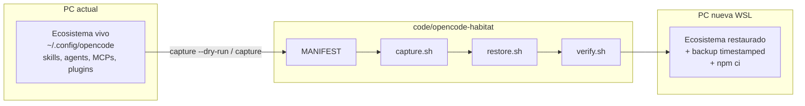

# Opencode Habitat 🌿
### Framework para trasplantar tu ecosistema opencode a cualquier PC con un comando

`habitat capture` → versiona ecosistema. `habitat restore` → reconstruye hábitat. `habitat verify` → prueba que vive.

  

> Origen real: `~/.config/opencode/`, `~/.claude/skills/`, `~/.agents/skills/`, `~/.gsd/`, `~/.opencode/`, `AGENTS.md`, dotfiles mínimos. Destino: WSL fresh con opencode ya instalado y keys conectadas.

## Por qué existe

Backup manual es tedioso y driftea: `opencode-backup-*.tar.gz`, `gsd-agents-backup-*`, `agents.bak-*` sueltos, `node_modules/` de 100M+ versionado por error, secretos (`jev.env`, `.git-credentials`) a un `git add -A` de filtrarse.

Habitat lo resuelve con 3 ideas:

1. **MANIFEST como única verdad** — cada path declara origen, destino, modo `copy`, excludes, post-steps `npm ci`.
2. **Copias, no symlinks** — determinista en WSL, inmune a `/mnt/c` y watchers.
3. **Seguridad fail-closed** — allowlist + `.gitignore` + scanner + hook pre-commit bloquean secretos antes del primer push.



## 2 flujos

### 1. Capturar / pushear (PC actual)

```bash
./scripts/capture.sh --dry-run   # ver drift repo-vs-máquina, read-only
./scripts/capture.sh             # rsync + denylist al home/ espejo
git status                       # cero secretos, cero junk
git push
```

### 2. Restaurar (PC nueva)

```bash
# prereqs: opencode instalado + autenticado, keys conectadas a mano
git clone <privado-habitat> ~/code/opencode-habitat
cd ~/code/opencode-habitat
./scripts/restore.sh   # backup-before-overwrite + copias + npm ci + verify.sh
```

Ver detalle visual: [docs/OVERVIEW.md](docs/OVERVIEW.md)

## Comandos

| Comando | Qué hace | Idempotente |
|---|---|---|
| `habitat capture` (`scripts/capture.sh`) | Snapshot re-ejecutable al `home/` espejo | sí |
| `habitat restore` (`scripts/restore.sh`) | Reconstruye todo, respalda `<file>.backup-<ts>` | sí, 2da corrida = no-op exit 0 |
| `habitat verify` (`scripts/verify.sh`) | Read-only: dests existen, `opencode` responde, MCP JSON válido, skills/plugins descubribles | sí |

## Seguridad

- Cero secretos en git: `jev.env` con valores, `.git-credentials`, `.claude.json` jamás versionados. Solo plantillas `.example`.
- Tres capas: exclusión estructural en MANIFEST → `.gitignore` backstop → scanner `grep -rEn` fail-closed + hook pre-commit.
- `*.local` y untracked machine-local nunca pisados por restore ni commiteados.
- Arranca **privado**. Abrir a público solo tras auditoría Fase 4 + restore test fechado en WSL limpio.

## Layout

```text
code/opencode-habitat/
├── README.md            # este archivo
├── docs/OVERVIEW.md     # arquitectura + flujos con diagramas
├── home/                # espejo de $HOME (solo paths del MANIFEST)
├── scripts/
│   ├── capture.sh       # Fase 2
│   ├── restore.sh       # Fase 3
│   └── verify.sh        # Fase 4
├── .planning/           # GSD: PROJECT, ROADMAP, STATE, phases/
└── .gitignore           # denylist secretos + junk
```

## Roadmap

- [ ] Fase 1: Inventory + Exclusions + Manifest (en curso)
- [ ] Fase 2: Capture Script
- [ ] Fase 3: Restore Script
- [ ] Fase 4: Verify + README + Fresh-WSL Test (release gate)

Ver [.planning/ROADMAP.md](.planning/ROADMAP.md)

## Contribuir / abrir a público

1. Mantener repo privado hasta `verify.sh` verde + test WSL limpio fechado.
2. Escrubear paths absolutos (`$HOME`, `$WINDOWS_USERS_ROOT`) y hostnames.
3. Exportar diagramas archify a `docs/*.html` + PNG para README.
4. Recién entonces hacer público.
