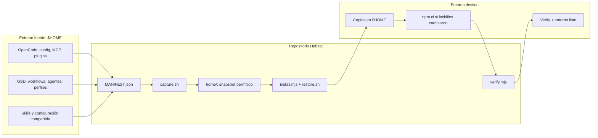

# OpenCode Habitat 🌿

Habitat versiona y restaura un ecosistema de OpenCode —configuración, GSD, agentes, skills, MCPs, plugins y herramientas— en otra máquina. Usa un manifiesto explícito, copias con backup y verificación al final.

`capture` → actualiza el snapshot del repo · `install/restore` → reconstruye el entorno · `verify` → comprueba que quedó operativo.

  

> **Recomendación por sistema:** Windows → PowerShell nativo (7/10/11) o WSL 2 + Ubuntu; Linux → terminal Bash; macOS → Bash con Homebrew. El instalador y el motor de restore son Node.js, así que los cuatro entornos comparten la misma ruta de reconstrucción. La captura (`capture.sh`) sigue siendo una herramienta de desarrollo para máquinas con Bash + rsync.

## Instalación desde una terminal nueva

### 1. Preparar el sistema

Se requieren **Git**, **Node.js 22.22.2+ / 24.15+ / 26+ y npm** y **OpenCode** en el mismo entorno donde ejecutarás Habitat. El motor de restore es Node.js puro: Windows nativo no necesita WSL, Bash, `rsync` ni coreutils para instalar y restaurar. La captura del snapshot (`scripts/capture.sh`) es una herramienta de desarrollo y sí requiere **Bash**, **rsync** y **coreutils** (`sha256sum`, `realpath`). Las versiones de Node reflejan el engine del lockfile actual. También necesitas acceso al repo privado.

**Qué hace falta para cada parte del ecosistema:**

| Para… | Necesitás |
|---|---|
| Instalar y restaurar (core) | Git + Node.js/npm + OpenCode. Nada más. |
| Router JEV (`gsd-jevs-route`) + perfiles | OpenCode autenticado y, opcionalmente, una key `TYPESAFE_API_KEY` en `~/.config/opencode/jev.env` (sin key, aplicás perfil a mano). |
| GSD (`get-shit-done-cc`) | `--with-gsd` (usa `npx`). |
| **Graphify** | **Python 3** en `PATH` (`pip`/`pipx` disponibles). Con `--with-deps` se instala `graphifyy`; **sin Python, el instalador lo omite con un aviso** y el resto del framework funciona igual, solo sin el grafo. |
| `context-mode` (plugin) | `--with-deps` (o `npm i -g`); el instalador también lo asegura. |
| `verify` completo (**6/6**) | Todo lo anterior + `opencode auth login` (para `model-ids`). |
| Capturar el snapshot | Bash + `rsync` + coreutils (solo máquina de desarrollo). |

O sea: el **framework queda operativo con solo Git+Node+OpenCode**; Python es lo único extra para tener **Graphify**.

#### Windows (PowerShell nativo)

En una terminal PowerShell, con Git, Node.js y OpenCode ya instalados:

```powershell
mkdir $HOME\code -Force
git clone https://github.com/FacundoECornet/Habitat.git $HOME\code\habitat
cd $HOME\code\habitat
powershell -ExecutionPolicy Bypass -File .\bootstrap.ps1 -WithDeps -WithGsd
```

`bootstrap.ps1` verifica Node/npm/Git, ejecuta `tools/install.mjs` (deps, GSD, restore y verify), agrega `%USERPROFILE%\bin` al `PATH` de usuario y recuerda autenticar OpenCode. Los binarios de `bin/` se instalan como `<nombre>.mjs` más un shim `<nombre>.cmd`, ejecutable desde PowerShell y `cmd.exe`. No hace falta tocar `/mnt/c`: clona en el disco de Windows (por ejemplo `C:\code\habitat`).

#### Instalar en una máquina corporativa (seguro y reversible)

Habitat **no toca la red corporativa, el firewall, el proxy ni ninguna política de sistema**. Todo lo que escribe vive bajo `%USERPROFILE%` (`bin`, `.config\opencode`, `.claude`, `.agents`, `.gsd`, `.opencode`, `.habitat\backups`); el único cambio "de sistema" es agregar `%USERPROFILE%\bin` al **PATH de usuario** (registro HKCU, no HKLM). Los paquetes npm globales (`get-shit-done-cc`, `context-mode`) van al *npm prefix* — per-usuario si Node es per-usuario. La red solo se **lee** (registro npm + `opencode`).

Secuencia recomendada para no arriesgar nada:

```powershell
# 1. Ver el plan sin escribir nada (read-only)
node tools\install.mjs --dry-run

# 2. Core sin instalaciones globales: valida Git + Node + OpenCode + store/restore
node tools\install.mjs

# 3. Comprobar (plugins puede fallar solo por context-mode ausente: esperado)
node tools\verify.mjs

# 4. Cuando quieras, sumar globales per-usuario (GSD, context-mode, Graphify) y auth
node tools\install.mjs --with-deps --with-gsd
opencode auth login
node tools\verify.mjs            # → 6/6
```

Si el *npm prefix* es de sistema y no querés tocar `Program Files`, fijalo a tu usuario (sin admin):

```powershell
npm config set prefix "$env:APPDATA\npm"
```

Reversión completa (deja la máquina como estaba):

```powershell
npm uninstall -g get-shit-done-cc context-mode
Remove-Item "$env:USERPROFILE\bin","$env:USERPROFILE\.config\opencode","$env:USERPROFILE\.claude","$env:USERPROFILE\.agents","$env:USERPROFILE\.gsd","$env:USERPROFILE\.opencode","$env:USERPROFILE\.habitat" -Recurse -Force
# y quitá %USERPROFILE%\bin del PATH de usuario si lo agregó bootstrap.ps1
```

#### Windows (alternativa: WSL 2 + Ubuntu)

En PowerShell, instala Ubuntu si WSL aún no está configurado y reinicia si Windows lo solicita:

```powershell
wsl --install -d Ubuntu
```

Abre Ubuntu desde el menú Inicio y, dentro de esa terminal Linux, instala las herramientas base:

```bash
sudo apt update
sudo apt install -y git bash rsync coreutils
```

Instala una versión compatible de Node.js (22.22.2+, 24.15+ o 26+) desde [Node.js](https://nodejs.org/en/download) y OpenCode **dentro de Ubuntu/WSL** siguiendo sus instrucciones oficiales: [OpenCode — instalación](https://opencode.ai/docs/). No ejecutes esta instalación desde `/mnt/c`: usa el filesystem Linux (`~/code/habitat`) para evitar problemas de permisos y rendimiento.

> OpenCode y Habitat instalados en Windows y en WSL son entornos distintos. WSL es la alternativa cuando querés un toolchain POSIX para desarrollo; para uso diario en Windows, PowerShell nativo (arriba) es el camino soportado y validado de extremo a extremo.

#### Linux (Debian / Ubuntu)

```bash
sudo apt update
sudo apt install -y git bash rsync coreutils
```

Instala una versión compatible de Node.js (22.22.2+, 24.15+ o 26+) y npm desde [Node.js](https://nodejs.org/en/download), y OpenCode según sus instrucciones oficiales: [OpenCode — instalación](https://opencode.ai/docs/). En distribuciones donde el paquete del sistema sea anterior a esas versiones, instala Node desde el sitio oficial antes de continuar.

#### macOS

Instala Xcode Command Line Tools si aún no tienes Git y Homebrew si no está instalado. Luego:

```bash
brew install git node rsync coreutils
export PATH="$(brew --prefix coreutils)/libexec/gnubin:$PATH"
```

Ese `PATH` hace visibles `sha256sum` y `realpath` de GNU coreutils para la herramienta de captura (`capture.sh`). Mantén la terminal Bash abierta para la instalación. Instala OpenCode siguiendo [OpenCode — instalación](https://opencode.ai/docs/).

### 2. Clonar, autenticar e instalar

En Windows nativo usa `.\bootstrap.ps1` (ver arriba). En WSL, Linux o macOS, desde una terminal Bash:

```bash
mkdir -p ~/code
git clone https://github.com/FacundoECornet/Habitat.git ~/code/habitat
cd ~/code/habitat

# Autenticar OpenCode en este mismo entorno antes de verificar modelos
opencode auth login

# Instalación completa: dependencias, GSD, restore del manifiesto y verify
node tools/install.mjs --with-deps --with-gsd
```

El repo es privado: GitHub debe autenticarte por SSH o HTTPS para que `git clone` funcione. El instalador crea `~/.config/opencode/jev.env` desde la plantilla si no existe; **no escribe credenciales**. Para habilitar clasificación JEV, añade en ese archivo una key propia (`TYPESAFE_API_KEY`) y abre una terminal Bash nueva. Sin credenciales JEV, la instalación funciona, pero el router de dificultad no cambia el perfil y devuelve código `2` de forma segura.

La instalación completa:

1. Detecta SO y arquitectura.
2. Con `--with-deps`, instala `get-shit-done-cc`, `context-mode` y Graphify (Graphify requiere **Python 3**; sin él se omite con aviso).
3. Con `--with-gsd`, instala GSD y reaplica los bloques Habitat solo si sus checksums coinciden.
4. Copia las herramientas ejecutables a `~/bin` (crea backup si ya existen).
5. Crea `jev.env` desde el ejemplo solo si falta.
6. Restaura las rutas permitidas por `MANIFEST.json`, ejecuta `npm ci` cuando los lockfiles cambiaron y respalda archivos que va a reemplazar.
7. Ejecuta `tools/verify.mjs` y reporta resultados.

Para restaurar sin instalar dependencias globales ni GSD:

```bash
node tools/install.mjs
```

> El instalador no instala OpenCode ni realiza el login del proveedor; esos pasos son previos. Los flags `--with-deps` y `--with-gsd` habilitan los componentes adicionales.

### 3. Comprobar la instalación

```bash
node tools/verify.mjs
node tools/verify.mjs --json          # salida para scripts
node tools/verify.mjs --no-models     # omite consulta de catálogo de modelos
```

`verify` revisa destinos del manifiesto, configuración MCP, herramientas CLI, plugins locales, descubrimiento de skills/agentes e IDs de modelos de los perfiles. Si aún no hay autenticación de OpenCode, `--no-models` permite omitir esa consulta.

## Cómo trabaja Habitat

### Esquema de componentes



`MANIFEST.json` es la fuente de verdad: enumera ocho raíces aprobadas, origen/destino, exclusiones y pasos posteriores. El payload vive bajo `home/` como espejo de `$HOME`. Habitat copia archivos (no usa symlinks), conserva archivos locales y huérfanos, crea backups timestamped antes de reemplazar contenido y no borra destinos.

### Tecnologías

| Tecnología | Uso |
|---|---|
| Git | Versionado del snapshot y distribución desde el repo privado. |
| Bash | Captura, validación del manifiesto y controles de seguridad (desarrollo). |
| Node.js / npm | Instalador multiplataforma, motor de restore (`tools/restore.mjs`), router JEV, herramientas GSD/Graphify, verificación y reconstrucción de dependencias desde lockfiles. |
| rsync + coreutils | Copias selectivas, comparación por checksum y utilidades de la captura (`capture.sh`, solo desarrollo). |
| GSD (get-shit-done-cc) | Flujos de trabajo de proyecto, planificación y ejecución por fases. |
| JEV | Clasificación de dificultad y selección controlada de perfiles Easy/Medium/Hard. |
| Graphify | Grafo local del proyecto, refrescado y verificado al cerrar una fase GSD. |
| OpenCode | Runtime de agentes, modelos, plugins y servidores MCP. |

No se versionan `node_modules`, binarios generados, backups ni credenciales. Las dependencias se reconstruyen desde manifests/lockfiles o se instalan con el instalador.

## Flujo de trabajo GSD

GSD organiza el trabajo del **proyecto donde lo uses**; sus artefactos (`.planning/`) pertenecen a ese proyecto, no al repo Habitat.

1. **Inicializar proyecto:** `/gsd-new-project` pregunta por objetivo y alcance; puede investigar la base de código y produce artefactos como `PROJECT.md`, `REQUIREMENTS.md` y `ROADMAP.md`.
2. **Elegir perfil de modelos:** durante el flujo de proyecto, `gsd-jevs-route` clasifica un resumen y propone `easy`, `medium` o `hard`. Solo aplica automáticamente con veredicto aceptado y umbrales de confianza/margen cumplidos. Si JEV falla o la respuesta es ambigua, sale con código `2` sin modificar archivos; el perfil se puede elegir manualmente.
3. **Preparar una fase:** GSD discute el alcance y crea contexto, investigación y planes (`CONTEXT.md`, `RESEARCH.md`, `PLAN.md`) en `.planning/phases/`.
4. **Ejecutar:** `/gsd-execute-phase <fase>` ejecuta planes por waves según dependencias y configuración, registra resúmenes por plan y conserva el estado en `.planning/STATE.md`.
5. **Verificar y cerrar:** GSD contrasta lo implementado con los planes/requisitos y genera evidencia de cierre. Al final `gsd-graphify-sync` actualiza el grafo y solo informa `Graphify: actualizado` si el archivo se regeneró; si falla, el resumen indica que no se actualizó.
6. **Continuar:** consultar `/gsd-progress` y preparar la siguiente fase del roadmap.

Atajos del router:

```bash
gsd-jevs-route "Resumen de 3–6 frases del proyecto y su alcance"
JEV_PROFILE_SOURCE=manual gsd-route medium  # easy | medium | hard
gsd-sdk query resolve-model gsd-planner     # consultar modelo efectivo
gsd-graphify-sync                           # refresco/verificación manual
```

Detalle visual de componentes y flujos: [docs/OVERVIEW.md](docs/OVERVIEW.md).

## Capturar cambios y publicar el snapshot

En la máquina fuente, revisar primero el diff en modo lectura:

```bash
./scripts/capture.sh --dry-run
./scripts/capture.sh
git status
```

Revisar los cambios, confirmar que no contienen secretos y luego hacer commit/push. El hook pre-commit y el scanner bloquean patrones de credenciales; no reemplazan la revisión del diff.

## Comandos y utilidades

| Comando | Función |
|---|---|
| `./scripts/capture.sh [--dry-run]` | Sincroniza los paths del manifiesto desde el home al snapshot. El dry-run es read-only. |
| `./scripts/restore.sh [--dry-run] [--verify]` | Restaura el snapshot al home (shim del motor Node; corre en Windows/WSL/Linux/macOS). |
| `.\bootstrap.ps1 [-WithDeps] [-WithGsd]` | Arranque en Windows nativo: instalación completa + `PATH` de usuario. |
| `node tools/install.mjs [opciones]` | Instala herramientas y ejecuta restore + verify. |
| `node tools/verify.mjs [--json] [--no-models] [--no-cli]` | Verificación funcional, read-only. |
| `gsd-jevs-route "resumen"` | Clasifica dificultad y aplica perfil solo con decisión automática válida. |
| `gsd-route <easy\|medium\|hard>` | Aplica perfil manual confirmado. |
| `gsd-graphify-sync` | Regenera el grafo y confirma que se actualizó. |

## Seguridad y recuperación

- **Allowlist por manifiesto:** solo se copian las ocho raíces declaradas en `MANIFEST.json`.
- **Secretos fuera del repo:** `jev.env`, tokens, `.git-credentials` y `.claude.json` no forman parte del payload. `jev.env.example` contiene nombres de variables, no valores.
- **Defensa por capas:** exclusiones del manifiesto, `.gitignore`, scanner fail-closed y hook pre-commit.
- **Backups antes de cambios:** los destinos modificados se renombran con sufijo `.backup-<timestamp>`; el instalador guarda sus copias bajo `~/.habitat/backups/`.
- **Idempotencia:** capture, restore e install pueden reejecutarse; en estado convergido, restore no modifica archivos.
- **No destructivo:** restore no elimina archivos locales, huérfanos ni `*.local`.

## Troubleshooting

- **`restore: rsync required` / `sha256sum required` (solo en la captura):** son dependencias de `capture.sh`, no del restore. El motor de restore es Node.js puro; para capturar instala `rsync` + coreutils (en macOS agrega `gnubin` al `PATH` como se muestra arriba).
- **Node anterior a 22.22.2 / 24.15 / 26 o `npm` ausente:** actualiza Node.js y vuelve a ejecutar la instalación.
- **`graphify` no responde o se omitió al instalar:** falta **Python 3**. Instalalo y `pipx install graphifyy` (o `pip install graphifyy==0.9.14`), luego `node tools/install.mjs --with-deps`. El resto del framework funciona igual sin Graphify.
- **`verify` falla en `model-ids`:** autentica OpenCode (`opencode auth login`) y reintenta. Si solo quieres omitir esa comprobación, usa `--no-models`.
- **`gsd-jevs-route` devuelve código `2`:** no se aplicó ningún perfil; revisa una key JEV o selecciona perfil manualmente con `JEV_PROFILE_SOURCE=manual gsd-route <easy|medium|hard>`.
- **Drift repo-vs-máquina:** `capture.sh --dry-run` y `restore.sh --dry-run` muestran diferencias sin escribir. Exit `1` significa que hay acciones pendientes.
- **Conflictos durante restore:** usa los archivos `.backup-<timestamp>` para recuperar la versión anterior; los archivos huérfanos del destino se preservan.
- **El comando `gsd-*` no aparece:** confirma que `~/bin` está en `PATH` o invoca el script con `node tools/<nombre>.mjs` desde el repo.

## Estructura del repositorio

```text
Habitat/
├── README.md                 # instalación, arquitectura y flujos
├── bootstrap.ps1             # arranque en Windows nativo (PowerShell)
├── MANIFEST.json             # declaración de los paths gestionados
├── home/                     # espejo allowlisted del home
├── scripts/                  # captura, restore (shim) y validación
├── tools/                    # instalador, motor de restore, router JEV, Graphify y verify (Node.js)
├── lib/                      # lector de manifiesto y scanner de secretos
├── tests/                    # suites Bash y Node.js
├── docs/OVERVIEW.md          # diagramas de arquitectura
└── .planning/                # planes, estado y reportes GSD de Habitat
```

## Verificación de desarrollo

Desde Linux, WSL o macOS con Bash, Node.js, `rsync` y coreutils:

```bash
for t in manifest-contract exclusion-rules restore restore-live-inputs capture path-leaks pre-commit-secret; do
  bash "tests/$t.sh" || exit 1
done
node --test tests/router-flow.mjs tests/install-verify.mjs tests/graphify-sync.mjs tests/restore-node.mjs
```

Las suites `restore-node`, `router-flow`, `install-verify` y `graphify-sync` son Node.js puro y también corren en Windows nativo (`node --test`); las suites Bash son de desarrollo POSIX.
