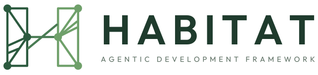
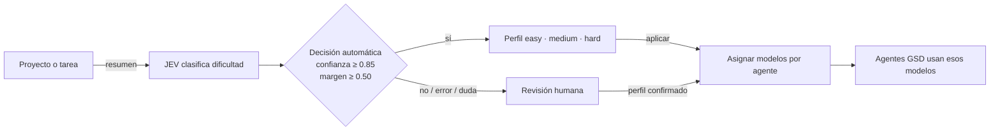

<p align="center">
  
</p>

<h1 align="center">Tu entorno de OpenCode, listo en cualquier máquina.</h1>

<p align="center">
  Configuración, GSD, agentes, skills y herramientas sincronizados, con backups y verificación.
</p>

<p align="center">
  
  
  
  
  
  
</p>

Habitat restaura tu entorno de OpenCode desde un manifiesto controlado: copia solo rutas
permitidas, conserva tus archivos anteriores y comprueba que la instalación quedó lista.

> Diagrama interactivo: [`docs/architecture.html`](docs/architecture.html) ·
> Explicación en detalle: [`docs/ARCHITECTURE.md`](docs/ARCHITECTURE.md)

## Qué es Habitat

Un snapshot declarativo de tu configuración de OpenCode (config, agentes, skills, plugins,
herramientas) que podés restaurar en otra máquina con un comando, sin copiar a ciegas tu home.

- **Restaura** configuración, skills, agentes, plugins y herramientas declaradas.
- **Protege** lo que ya existe: copia con timestamp antes de reemplazarlo.
- **Verifica** destinos, plugins, herramientas y modelos configurados.
- **Mantiene** credenciales y archivos locales fuera del snapshot.

## Requisitos

Necesitás **[Git](https://git-scm.com/downloads)**, **[Node.js/npm](https://nodejs.org/en/download)**
y **[OpenCode](https://opencode.ai/docs/)** instalados. Node.js **22.22.2+**, **24.15+** o **26+**.

| Tarea | Requisito adicional |
|---|---|
| Usar Habitat en Windows | PowerShell 5.1+; WSL no es necesario. |
| Usar GSD | Instala con `--with-gsd`. |
| Instalar Graphify | Python 3; se instala con `--with-deps`. |
| Capturar cambios para mantener tu snapshot | Bash, `rsync` y GNU coreutils. |

<sub>OpenCode no se instala ni autentica desde Habitat: eso se hace una vez por entorno.</sub>

## Instalación

El repositorio es público: clonalo sin credenciales. Elegí tu terminal.

<details open>
<summary><strong>Windows · PowerShell</strong></summary>

No necesitás WSL.

```powershell
New-Item -ItemType Directory -Force "$HOME\code" | Out-Null
git clone https://github.com/FacundoECornet/Habitat.git "$HOME\code\habitat"
Set-Location "$HOME\code\habitat"
opencode.cmd auth list
powershell -ExecutionPolicy Bypass -File .\bootstrap.ps1 -WithDeps -WithGsd
```

</details>

<details>
<summary><strong>Linux · macOS · WSL 2</strong></summary>

Instalá Git, Node.js/npm y OpenCode según sus guías oficiales. En WSL, corré todo desde la
terminal Linux y guardá el repo en `~/code`, nunca en `/mnt/c`.

```bash
mkdir -p ~/code
git clone https://github.com/FacundoECornet/Habitat.git ~/code/habitat
cd ~/code/habitat
opencode auth list
node tools/install.mjs --with-deps --with-gsd
```

</details>

Después de instalar, cerrá y volvé a abrir OpenCode para cargar el MCP global y los plugins.

> **¿Solo querés restaurar el entorno?** Corré `node tools/install.mjs` sin flags:
> `--with-deps` instala herramientas opcionales y `--with-gsd` instala GSD.

> El instalador abre un selector de modelos **por rol** (`planner`, `writer`, `executor`,
> `checker`): cada modelo se aplica a todos los sub-agentes de ese rol. `Enter` mantiene,
> `!` vuelve al default del repo y `q` termina.

## Verificación

El instalador restaura la configuración y corre la verificación al final. Podés volver a
comprobarla cuando quieras:

```bash
node tools/verify.mjs
```

| Check | Qué garantiza |
|---|---|
| `manifest-dests` | Todo destino del manifiesto existe. |
| `mcp-json` | La config de MCP parsea y cada servidor está declarado como local. |
| `cli-tools` | `gsd-sdk` y `graphify` responden. |
| `plugins` | Cada plugin declarado (local o npm) resuelve. |
| `discovery` | Skills y agentes son descubribles y no están duplicados. |
| `model-ids` | Cada modelo configurado existe en el catálogo de OpenCode. |
| `portable-paths` | No quedan placeholders ni rutas de otra máquina. |
| `jev-mcp` | El MCP de JEV responde — o queda en `skip` si no hay credencial de OpenCode Zen. |

Un check en `skip` no hace fallar la instalación; un check que falla siempre trae un hint
accionable.

## Sin credencial de OpenCode Zen

**JEV es opcional.** Si no tenés cuenta de OpenCode Zen, todo el resto funciona igual: GSD,
agentes, skills, Caveman, plugins, captura, restore y verificación.

Queda desactivado:

- El MCP de JEV (no se instala la entrada `mcp.jev` en tu config).
- El router por dificultad (`gsd-route`) que asigna perfiles de modelo automáticamente.

Para activarlo más tarde:

```bash
opencode auth login          # elegí OpenCode Zen
node tools/install.mjs        # reinstala y conecta el MCP
```

## GSD + JEV, en pocas palabras

JEV estima la dificultad del proyecto y Habitat asigna un perfil de modelos a los agentes GSD.
Si la clasificación no es segura, no cambia nada: podés elegir perfil manualmente.



| Perfil | Para qué sirve |
|---|---|
| `easy` | Cambios pequeños y de bajo riesgo. |
| `medium` | Funcionalidad acotada o varios archivos. |
| `hard` | Cambios de arquitectura, transversales o inciertos. |

La clasificación automática requiere un proveedor JEV configurado. También podés elegir perfil
a mano:

```bash
gsd-route medium
```

> Diagrama interactivo del flujo: [`docs/jev-profiles.html`](docs/jev-profiles.html)

### Caveman

Habitat incluye el plugin y los comandos de Caveman para controlar cuánto se comprime el estilo
de respuesta. Usá `/caveman lite|full|ultra|wenyan` para cambiar el nivel; `stop caveman` o
`normal mode` vuelve al estilo normal. `/caveman-help` muestra la ayuda.

Graphify es opcional y requiere Python 3. Sin Python, el resto de Habitat sigue funcionando.

## Troubleshooting

| Síntoma | Qué hacer |
|---|---|
| El clonado falla por red | Si tu red intercepta TLS, exportá `NODE_EXTRA_CA_CERTS=/ruta/a/ca.crt` o instalá la CA de tu red en el sistema. |
| `npm ci` falla con `UNABLE_TO_VERIFY_LEAF_SIGNATURE` | Habitat reintenta con el almacén de CA del sistema. Si tampoco alcanza: `NODE_EXTRA_CA_CERTS=/ruta/a/ca.crt`. |
| PowerShell bloquea `npm.ps1` | Usá `npm.cmd` en vez de `npm` (`npm.cmd test`). |
| `verify` falla en `model-ids` | `opencode auth login` y volvé a correr `node tools/verify.mjs`. |
| El MCP `jev` no levanta | Confirmá `OpenCode Zen` con `opencode.cmd auth list` (Windows) o `opencode auth list` (Linux/macOS) y reconectá. Diagnóstico: `opencode --print-logs --log-level DEBUG mcp list`. |
| `jev` no aplica perfil | `gsd-route easy|medium|hard` para elegir perfil manualmente. |
| `graphify` no está disponible | Instalá Python 3 y volvé a correr `node tools/install.mjs --with-deps`. |

## Mantener tu propio snapshot

`scripts/capture.sh` relee tu entorno y actualiza el payload del repo. Es re-ejecutable,
soporta `--dry-run` y nunca commitea secretos ni junk. Requisitos: Bash, `rsync` y coreutils
(en Windows: usá WSL para capturar).

Ver [`docs/CAPTURE.md`](docs/CAPTURE.md).

## Estado del proyecto

Etapa 1 cerrada: restore, verificación, captura, GSD, skills y plugins funcionan en Windows,
Linux, macOS y WSL. Lo que sigue está en el [CHANGELOG](CHANGELOG.md) y en los issues abiertos.

## Licencia y contribución

[MIT](LICENSE) · atribuciones en [THIRD_PARTY_NOTICES.md](THIRD_PARTY_NOTICES.md) ·
cómo contribuir en [CONTRIBUTING.md](CONTRIBUTING.md) ·
cómo reportar un problema en [SECURITY.md](SECURITY.md).
