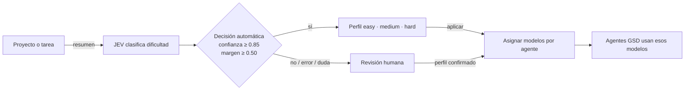

<p align="center">
  
</p>

<h1 align="center">Tu entorno de OpenCode, listo en cualquier máquina.</h1>

<p align="center">
  Configuración, GSD, agentes y herramientas sincronizados con backups y verificación.
</p>

<p align="center">
  
  
  
</p>

Habitat restaura tu entorno de OpenCode desde un manifiesto controlado. Copia solo rutas permitidas, conserva tus archivos anteriores y comprueba que la instalación quedó lista.

## Empezar

Necesitas **[Git](https://git-scm.com/downloads)**, **[Node.js/npm](https://nodejs.org/en/download)** y **[OpenCode](https://opencode.ai/docs/)** instalados. Usa Node.js **22.22.2+**, **24.15+** o **26+**. Inicia sesión en OpenCode antes de instalar.

El repositorio requiere acceso de GitHub. Elige tu terminal:

<details>
<summary><strong>Windows · PowerShell</strong></summary>

No necesitas WSL.

```powershell
New-Item -ItemType Directory -Force "$HOME\code" | Out-Null
git clone https://github.com/FacundoECornet/Habitat.git "$HOME\code\habitat"
Set-Location "$HOME\code\habitat"
opencode.cmd auth list
# Solo si OpenCode Zen no aparece en la lista:
opencode.cmd auth login
powershell -ExecutionPolicy Bypass -File .\bootstrap.ps1 -WithDeps -WithGsd
```

</details>

<details>
<summary><strong>Linux · macOS · WSL 2</strong></summary>

Instala Git, Node.js/npm y OpenCode siguiendo sus guías oficiales. En WSL, ejecuta todo desde la terminal Linux y guarda el repo en `~/code`, no en `/mnt/c`.

```bash
mkdir -p ~/code
git clone https://github.com/FacundoECornet/Habitat.git ~/code/habitat
cd ~/code/habitat
opencode auth list
# Solo si OpenCode Zen no aparece en la lista:
opencode auth login
node tools/install.mjs --with-deps --with-gsd
```

</details>

Si `auth list` no muestra **OpenCode Zen**, ejecuta `auth login` y selecciónalo. Habitat instala MCP JEV globalmente para tu usuario y reutiliza credencial guardada por OpenCode; proyectos nuevos la reciben sin configuración propia ni una segunda API key.

El instalador restaura la configuración y ejecuta una verificación al final. Puedes volver a comprobarla cuando quieras:

```bash
node tools/verify.mjs
```

Al terminar, cierra y vuelve a abrir OpenCode para cargar el MCP global y los plugins.

> **¿Solo quieres restaurar el entorno?** Ejecuta `node tools/install.mjs` sin flags. `--with-deps` instala herramientas opcionales; `--with-gsd` instala GSD.

> El instalador abre un selector de modelos **por rol** (`planner`, `writer`, `executor`, `checker`): cada modelo se aplica a todos los sub-agentes de ese rol, y podes aplicar los mismos 4 a los tres perfiles. `Enter` mantiene, `!` vuelve al default del repo y `q` termina.

Habitat instala `@jkudish/jev-mcp` junto con el resto de dependencias y lo conecta a `jev-1.13-free` en OpenCode Zen. El launcher lee la credencial que `opencode auth login` ya guardó en el perfil local; no pide `TYPESAFE_API_KEY` ni `JEV_API_KEY`. **Jev 1.13 Free está disponible por tiempo limitado.**

## GSD + JEV, en pocas palabras

JEV estima la dificultad del proyecto y Habitat asigna un perfil de modelos a los agentes GSD. Si la clasificación no es segura, no cambia nada: puedes elegir perfil manualmente.



| Perfil | Para qué sirve |
|---|---|
| `easy` | Cambios pequeños y de bajo riesgo. |
| `medium` | Funcionalidad acotada o varios archivos. |
| `hard` | Cambios de arquitectura, transversales o inciertos. |

JEV aplica un perfil solo con decisión automática y confianza/margen suficientes. Si no, pide revisión. La clasificación automática requiere un proveedor JEV configurado; también puedes elegir perfil manualmente:

```bash
gsd-route medium
```

Abre o descarga el [diagrama interactivo de Archify](.archify/workflow-gsd-jev-perfiles-20261018-050739/workflow-gsd-jev-perfiles.html).

## Qué hace Habitat

- **Restaura** configuración, skills, agentes, plugins y herramientas declaradas.
- **Protege** archivos existentes con copias de respaldo antes de reemplazarlos.
- **Verifica** destinos, plugins, herramientas y modelos configurados.
- **Mantiene** credenciales y archivos locales fuera del snapshot.

Graphify es opcional y requiere Python 3. Sin Python, el resto de Habitat sigue funcionando.

### Caveman

Habitat incluye el plugin y los comandos de Caveman para controlar cuánto se comprime el estilo de respuesta. Usa `/caveman lite|full|ultra|wenyan` para cambiar el nivel; `stop caveman` o `normal mode` vuelve al estilo normal. También puedes usar `/caveman-help` para ver la ayuda.

## Ayuda rápida

- **Falta acceso al clonar:** inicia sesión en GitHub con una cuenta autorizada para el repositorio.
- **`verify` falla en modelos:** ejecuta `opencode auth login` y vuelve a correr `node tools/verify.mjs`.
- **JEV falla o MCP muestra timeout:** confirma `OpenCode Zen` con `opencode.cmd auth list` (Windows) o `opencode auth list` (Linux/macOS); vuelve a conectar con `opencode.cmd auth login` / `opencode auth login` y reinicia OpenCode. Diagnóstico MCP: `opencode.cmd --print-logs --log-level DEBUG mcp list` (Windows) o `opencode --print-logs --log-level DEBUG mcp list`.
- **JEV no aplica perfil:** usa `gsd-route easy|medium|hard` para seleccionar perfil manualmente.
- **`graphify` no está disponible:** instala Python 3 y vuelve a ejecutar `node tools/install.mjs --with-deps`.

## Requisitos por tarea

| Tarea | Requisito adicional |
|---|---|
| Usar Habitat en Windows | PowerShell 5.1+; WSL no es necesario. |
| Usar GSD | Instala con `--with-gsd`. |
| Instalar Graphify | Python 3; se instala con `--with-deps`. |
| Capturar cambios para mantener el snapshot | Bash, `rsync` y GNU coreutils. |

<sub>OpenCode no se instala ni autentica desde Habitat. Esos pasos se hacen una vez en cada entorno.</sub>
