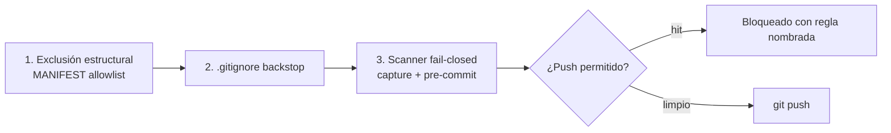

# Arquitectura — Habitat

> Habitat restaura tu entorno de OpenCode en cualquier máquina: captura declarativa,
> restore idempotente y verificación que cierra el loop de confianza.

Este documento explica qué se restaura, a dónde, cómo se decide y cómo se verifica.

## 1. El modelo


- **MANIFEST.json** es la allowlist: cada entrada dice qué ruta se copia y a qué
  destino. Nada fuera del manifiesto se captura.
- **home/** es el espejo versionado del entorno de origen.
- **restore.mjs** (Node, multiplataforma) es el motor: hace backup de lo que va a
  pisar, copia el payload, ejecuta los post-steps (`npm ci`) y es idempotente.
- **verify.mjs** comprueba que el entorno restaurado quedó funcional.

## 2. Qué se restaura y a dónde

| Origen en el repo | Destino en la máquina | Contenido |
|---|---|---|
| `home/.config/opencode/` | `~/.config/opencode/` | Config, agentes, comandos, skills, router por perfil |
| `home/.agents/skills/` | `~/.agents/skills/` | Skills portables (Archify, find-skills, typesafe-ai) |
| `home/.claude/skills/` | `~/.claude/skills/` | Skills de GSD |
| `home/.gsd/` | `~/.gsd/` | Configuración del router de GSD |

El payload **no** incluye archivos de shell ni de convenciones del hogar: `~/.bashrc`,
`~/AGENTS.md` o `~/.gitconfig` son personales y quedan en la máquina que los escribió. Lo
único que Habitat agrega al entorno es el `~/bin` en el `PATH`, y lo hace el instalador (no
un snapshot).

El destino nunca se borra: lo que va a ser pisado se copia antes a
`~/.habitat/backups/<timestamp>/`.

## 3. Verificación

`node tools/verify.mjs` corre diez comprobaciones y devuelve código de salida 0
solo si todas pasan:

| Check | Qué garantiza |
|---|---|
| `manifest-dests` | Todo destino del manifiesto existe en la máquina. |
| `portable-paths` | No quedan placeholders ni rutas absolutas de otra máquina (POSIX, Windows y WSL). |
| `mcp-json` | La config de MCP parsea y cada servidor está declarado como local. |
| `jev-mcp` | El MCP de JEV responde — o queda en `skip` si no hay credencial de OpenCode Zen. |
| `cli-tools` | `gsd-sdk` y `graphify` responden; si no están instalados, se informa en verde. (`--no-cli` lo omite) |
| `plugins` | Cada plugin declarado (local o npm) resuelve. |
| `opencode-cli` | Qué línea de OpenCode se está usando y por qué vía llega context-mode; falla si no llega por ninguna. |
| `discovery` | Skills y agentes son descubribles y no están duplicados entre roots. |
| `archify` | La skill de Archify viene completa y su doctor responde. |
| `model-ids` | Cada modelo configurado existe en el catálogo de OpenCode. (`--no-models` lo omite) |

Un check puede quedar en `skip` (no se puede evaluar en esta máquina: falta la
CLI, falta una credencial) y eso **no** hace fallar el run. Un check que falla
siempre viene con un hint accionable.

`model-ids` solo puede declarar un ID inválido cuando el catálogo está
**completo**, y el catálogo está completo cuando trae el namespace autenticado
(`opencode-go/*`), que solo aparece con credencial. Sin credencial, el listado
público es un subconjunto que todavía anuncia modelos que OpenCode ya retiró:
marcar un ID como inválido con ese listado rompería la instalación de todo el
mundo sin motivo.

Aun con el namespace autenticado presente, el CLI puede caer a su snapshot
empaquetado y omitir IDs nuevos de `opencode-go/*` (pasó con
`opencode-go/longcat-2.5-preview-free` en macOS con OpenCode 1.19.3). Esa
ausencia no prueba retiro: el check la reporta como **sin verificar** y solo
falla con IDs del namespace público. El veredicto duro de retiro lo emite el
job semanal.

Fuera de la instalación hay un segundo control, `tools/check-model-ids.mjs`:
compara el payload contra el catálogo y, con el catálogo completo, sale con
código 1 y lista dónde aparece cada ID retirado. Es lo que corre el job
semanal de la CI.

## 4. Capas de seguridad



1. **Allowlist, no denylist.** Solo lo que el manifiesto declara entra al repo.
2. **`.gitignore` como red de seguridad** para artefactos regenerables.
3. **Scanner de secretos** fail-closed en `capture.sh` y en el hook de
   pre-commit. Reporta regla, ruta y línea; nunca el valor detectado.
4. **El instalador activa el hook** en el repo desde el que se instala
   (`core.hooksPath=.githooks`, solo config local del repo: la global de Git
   no se toca y un valor propio del usuario no se pisa).

Patrones cubiertos: `apikey_`, `gh[op]_`, `sk-`, `xoxb-`,
`BEGIN PRIVATE KEY`.

> El hook es una red de seguridad del flujo de trabajo, **no** una frontera de
> seguridad: `git commit --no-verify` lo salta por diseño.

## 5. Plataformas

| Plataforma | Ruta de instalación |
|---|---|
| Windows (PowerShell) | `git clone` → `opencode.cmd auth list` → `bootstrap.ps1 -WithDeps -WithGsd` |
| Linux / macOS / WSL | `git clone` → `opencode auth list` → `node tools/install.mjs --with-deps --with-gsd` |

El motor de restore es Node puro: no hace falta WSL, ni rsync, ni coreutils en
la máquina destino. La captura (`scripts/capture.sh`) sí es POSIX y se ejecuta
en la máquina de origen (en Windows: desde WSL).

Las tres plataformas están probadas en la CI, no solo declaradas:

| Plataforma | Qué corre |
|---|---|
| Ubuntu | Node 22.22.2, 24 y 26: suite, gates del repo y smoke de install + verify. |
| macOS | Lo mismo, sobre un macOS real de Apple Silicon: el tooling Bash se prueba con las herramientas BSD de verdad. |
| Windows | Lo mismo, en PowerShell: sin WSL y sin Bash. |

Además, un job semanal revisa el catálogo de modelos de OpenCode y abre un
issue con la lista exacta de agentes y perfiles afectados cuando un ID público
se retira del catálogo.

## 6. Las dos líneas de OpenCode

OpenCode 2.x no comparte el contrato de plugins con 1.x: 1.x llama `server(ctx)`
y 2.x llama `setup(ctx)`, y solo acepta un default export con `id` + `setup`. Un
plugin escrito para 1.x no carga en 2.x.

El MCP **sí** es el mismo en las dos líneas, así que es la vía estable:

```mermaid
flowchart LR
    CLI{opencode --version}
    CLI -->|1.x| P1[plugin nativo de context-mode<br/>en proceso]
    CLI -->|2.x| P2[plugin nativo: NO carga<br/>el host lo loguea como error]
    CLI -->|2.x| M[context-mode declarado<br/>como servidor MCP (hijo stdio)]
    P1 --> T[las herramientas ctx_*]
    M --> T
```

- El **instalador** lee la versión del CLI y adapta la config: en 1.x declara el
  plugin nativo; en 2.x lo quita y declara el servidor MCP.
- El **check `opencode-cli`** dice en verde qué línea estás usando y por qué vía
  llega context-mode, y falla si no llega por ninguna. Antes, un plugin que no
  cargaba pasaba la verificación en verde.
- El check `jev-mcp` ya no se apoya en `opencode mcp list` (su formato cambió
  entre líneas) sino en un handshake JSON-RPC contra el launcher, igual que un
  cliente MCP real.
- Los plugins del payload (Caveman, Graphify) exportan las dos formas. El guard
  de `setup` (sin dominio `session`/`tool` no hace nada) deja la parte 2.x
  inerte en 1.x, que también invoca `setup` pero con un contexto parcial: así
  ningún hook queda registrado dos veces.
- Queda fuera en 2.x: los hooks de routing de context-mode, hasta que upstream
  publique su entrada 2.x (el fix ya está en su repo, sin publicar).

La CI corre las dos líneas (`OpenCode 1.19.3` y `OpenCode 2.1.0`) sobre el
payload, no solo sobre una.

## 7. Capturar tu propio snapshot

`scripts/capture.sh` relee tu entorno y actualiza el payload del repo. Es
re-ejecutable, soporta `--dry-run` y nunca commitea secretos ni junk.
Requisitos: Bash y `rsync` (en Windows: usar WSL para capturar).

El veredicto de drift del `--dry-run` lo decide la accounting del propio motor
(checksum de contenido más bit ejecutable), no el formato de la salida de
rsync: el rsync de macOS itemiza diferencias de mtime sobre un árbol
convergente, y un preview que dijera "drift" siempre no serviría de nada. Los
excludes del manifiesto se aplican a los dos lados del comparativo, así que lo
que el manifiesto deja fuera (`node_modules/`, `*.bak*`, `*.local`, los backups
con timestamp) no se cuenta como drift ni se publica.

Ver `docs/CAPTURE.md`.
