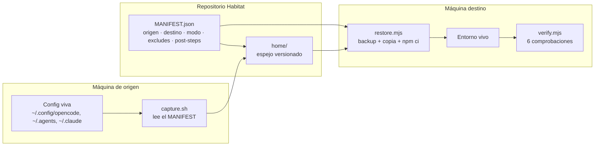
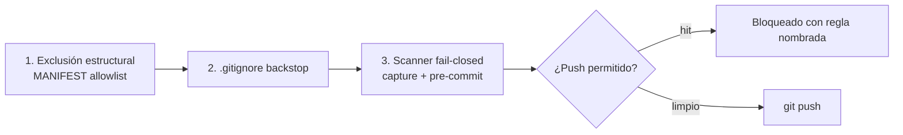

# Arquitectura — Habitat

> Habitat restaura tu entorno de OpenCode en cualquier máquina: captura declarativa,
> restore idempotente y verificación que cierra el loop de confianza.

Este documento explica qué se restaura, a dónde, cómo se decide y cómo se verifica.

## 1. El modelo

- **MANIFEST.json** es la allowlist: cada entrada dice qué ruta se copia y a qué
  destino. Nada fuera del manifiesto se captura.
- **home/** es el espejo versionado del entorno de origen.
- **restore.mjs** (Node, multiplataforma) es el motor: hace backup de lo que va a
  pisar, copia el payload, ejecuta los post-steps (`npm ci`) y es idempotente.
- **verify.mjs** comprueba que el entorno restaurado quedó funcional.

## 2. Qué se restaura y a dónde

| Origen en el repo | Destino en la máquina | Contenido |
|---|---|---|
| `home/.config/opencode/` | `~/.config/opencode/` | Config, agentes, comandos, skills, router por perfil |
| `home/.agents/skills/` | `~/.agents/skills/` | Skills portables (Archify, find-skills, typesafe-ai) |
| `home/.claude/skills/` | `~/.claude/skills/` | Skills de GSD |
| `home/.gsd/` | `~/.gsd/` | Configuración del router de GSD |

El payload **no** incluye archivos de shell ni de convenciones del hogar: `~/.bashrc`,
`~/AGENTS.md` o `~/.gitconfig` son personales y quedan en la máquina que los escribió. Lo
único que Habitat agrega al entorno es el `~/bin` en el `PATH`, y lo hace el instalador (no
un snapshot).

El destino nunca se borra: lo que va a ser pisado se copia antes a
`~/.habitat/backups/<timestamp>/`.

## 3. Verificación

`node tools/verify.mjs` corre seis comprobaciones y devuelve código de salida 0
solo si todas pasan:

| Check | Qué garantiza |
|---|---|
| `manifest-dests` | Todo destino del manifiesto existe en la máquina. |
| `mcp-json` | La config de MCP parsea y cada servidor está declarado como local. |
| `cli-tools` | `gsd-sdk` y `graphify` responden. (`--no-cli` lo omite) |
| `plugins` | Cada plugin declarado (local o npm) resuelve. |
| `discovery` | Skills y agentes son descubribles y no están duplicados entre roots. |
| `model-ids` | Cada modelo configurado existe en el catálogo de OpenCode. (`--no-models` lo omite) |
| `portable-paths` | No quedan placeholders ni rutas absolutas de otra máquina. |
| `jev-mcp` | El MCP de JEV responde — o queda en `skip` si no hay credencial de OpenCode Zen. |

Un check puede quedar en `skip` (no se puede evaluar en esta máquina: falta la
CLI, falta una credencial) y eso **no** hace fallar el run. Un check que falla
siempre viene con un hint accionable.

## 4. Capas de seguridad

1. **Allowlist, no denylist.** Solo lo que el manifiesto declara entra al repo.
2. **`.gitignore` como red de seguridad** para artefactos regenerables.
3. **Scanner de secretos** fail-closed en `capture.sh` y en el hook de
   pre-commit. Reporta regla, ruta y línea; nunca el valor detectado.

Patrones cubiertos: `apikey_`, `gh[op]_`, `sk-`, `xoxb-`,
`BEGIN PRIVATE KEY`.

> El hook es una red de seguridad del flujo de trabajo, **no** una frontera de
> seguridad: `git commit --no-verify` lo salta por diseño.

## 5. Plataformas

| Plataforma | Ruta de instalación |
|---|---|
| Windows (PowerShell) | `git clone` → `opencode.cmd auth list` → `bootstrap.ps1 -WithDeps -WithGsd` |
| Linux / macOS / WSL | `git clone` → `opencode auth list` → `node tools/install.mjs --with-deps --with-gsd` |

El motor de restore es Node puro: no hace falta WSL, ni rsync, ni coreutils en
la máquina destino. La captura (`scripts/capture.sh`) sí es POSIX y se ejecuta
en la máquina de origen.

## 6. Capturar tu propio snapshot

`scripts/capture.sh` relee tu entorno y actualiza el payload del repo. Es
re-ejecutable, soporta `--dry-run` y nunca commitea secretos ni junk.
Requisitos: Bash, `rsync` y coreutils (en Windows: usar WSL para capturar).

Ver `docs/CAPTURE.md`.
